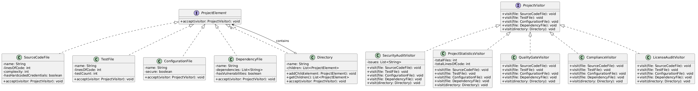
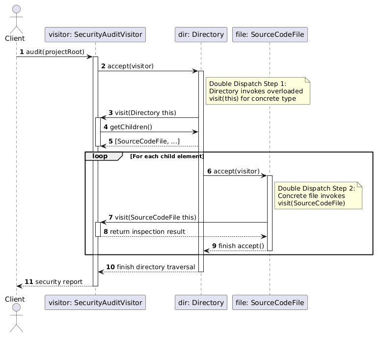

# Assignment 6: Smart Code Inspection & Compliance Engine

## 1. Core Architecture & Visitor Pattern

- **Problem:** Avoid `instanceof` checks, large `switch` statements, and mixing inspection logic directly inside element classes, adhering to the Open/Closed Principle (OCP).
- **Context:** The project contains various software file elements (`SourceCodeFile`, `TestFile`, `ConfigurationFile`, `DependencyFile`, `Directory`) that must be processed by different operations (Security Audit, Statistics, Quality Gates, Compliance, License Audit).
- **Pattern Mechanism:** The Visitor pattern uses **double dispatch** to decouple operations from the object structure. Elements accept a visitor, and the visitor executes the appropriate overloaded `visit(...)` method for that concrete element type.

---

## 2. Element Hierarchy & Structure
- **Interface:** `ProjectElement` defines `void accept(ProjectVisitor visitor);`.
- **Concrete Elements:**
  - `SourceCodeFile` (lines of code, complexity, security flags)
  - `TestFile` (test counts, lines)
  - `ConfigurationFile` (secure settings)
  - `DependencyFile` (list of libraries, vulnerability flags)
  - `Directory` (contains nested `ProjectElement` items, supporting recursive traversal)

---

## 3. Difference between Visitor and Strategy
- **Visitor:** Focuses on adding new **operations** over a stable object hierarchy without changing the classes of those objects.
- **Strategy:** Focuses on selecting and swapping interchangeable **algorithms** at runtime to achieve a specific single task.

---

## 4. SOLID Principles Applied
- **Single Responsibility Principle (SRP):** Each visitor handles a single specific concern (e.g., `SecurityAuditVisitor` handles only security checks).
- **Open/Closed Principle (OCP):** New visitors (like `LicenseAuditVisitor`) can be added without modifying any existing element classes.
- **Liskov Substitution Principle (LSP):** Concrete elements and visitors can be replaced seamlessly through their respective interfaces.
- **Interface Segregation Principle (ISP):** `ProjectVisitor` and `ProjectElement` define focused, cohesive contracts.
- **Dependency Inversion Principle (DIP):** High-level modules and operations depend on abstractions (`ProjectElement`, `ProjectVisitor`).

---

## 5. UML Diagrams
### Class Diagram


### Sequence Diagram


---

## 6. How to Add a New Visitor vs Element
- **Adding a New Visitor:** Create a class implementing `ProjectVisitor` and implement all `visit(...)` methods. **No modification to existing elements is required.**
- **Adding a New Element (e.g., `DatabaseMigrationFile`):** Requires modifying the `ProjectVisitor` interface and **every single concrete visitor** to implement `visit(DatabaseMigrationFile)`. This highlights the limitation of the Visitor pattern when the element structure changes frequently.

---

## 7. Architecture Limitations
- Visitor is a poor choice if the object structure changes frequently, because adding a new concrete element forces updates across all existing visitor implementations.

---

## 8. README Questions & Answers

1. **What problem does Visitor solve in your project?**  
   It decouples complex operations (security audits, statistics, quality gates) from the data structure, preventing bloated element classes and eliminating `instanceof` / `switch` type-checking blocks.
2. **Where are Element and Visitor?**  
   Elements are located in `com.inspection.engine.elements`, and Visitors are located in `com.inspection.engine.visitors`.
3. **What is double dispatch?**  
   A mechanism where the executed operation depends on two message receptions: first, the concrete type of the element receiving `accept(visitor)`, and second, the concrete type of the visitor receiving `visit(this)`.
4. **Why not put all operations directly inside the Element classes?**  
   It would violate the Single Responsibility Principle, clutter element classes with unrelated code (security, stats, compliance), and violate OCP whenever a new check is added.
5. **Is it easier to add a new Visitor or a new Element? Why?**  
   It is much easier to add a new **Visitor**, because it requires zero modifications to existing element classes. Adding a new Element requires updating the Visitor interface and all existing visitors.
6. **When would Visitor be a bad choice?**  
   When the domain model (element hierarchy) is unstable and frequently changes or expands with new element types.
7. **How is Visitor different from Strategy?**  
   Visitor targets a stable structure of heterogeneous objects to perform multi-type operations, whereas Strategy encapsulates a single algorithm to swap behavior dynamically.
8. **Which SOLID principles can you identify?**  
   Open/Closed Principle (OCP), Single Responsibility Principle (SRP), Dependency Inversion Principle (DIP), Liskov Substitution Principle (LSP), and Interface Segregation Principle (ISP).

---

## 9. Test Results & Execution Demo

### Unit Test Suite (JUnit 5)
All 12 unit tests executed and passed successfully:

```text
✔ VisitorPatternTest (com.inspection.engine) (62 ms)
    ✔ Test 10: Test-to-Source ratio calculation (32 ms)
    ✔ Test 6: Quality Gate FAIL due to high complexity (2 ms)
    ✔ Test 1: Empty directory traversal (1 ms)
    ✔ Test 5: Quality Gate PASS status (1 ms)
    ✔ Test 7: Compliance Visitor detects unversioned dependency (3 ms)
    ✔ Test 9: License Audit custom visitor detection (1 ms)
    ✔ Test 3: Security audit detects exposed secrets (23 ms)
    ✔ Test 11: Edge Case - Multiple issues across mixed elements
    ✔ Test 4: Security audit detects vulnerable dependencies
    ✔ Test 8: Deeply nested directory hierarchy traversal
    ✔ Test 2: Source code metrics evaluation
    ✔ Test 12: Edge Case - Dependency file without vulnerabilities
    
    Test Results: 12 tests passed, 0 failed.

```

### Fintech Project Demo Output

Execution of the main inspection pipeline (`Main.java`):

```text
=== 1. SECURITY AUDIT VISITOR ===
-> Scanning directory for security: fintech-project
-> Scanning directory for security: src
  [SECURITY WARNING] Source file 'PaymentService.java' contains hardcoded credentials!
  [OK] Source file 'UserService.java' passed security check.
-> Scanning directory for security: tests
  [OK] Test file 'PaymentServiceTest.java' is secure.
-> Scanning directory for security: config
  [OK] Configuration file 'application.properties' is secure.
  [OK] Dependency file 'pom.xml' has no known vulnerabilities.

=== 2. PROJECT STATISTICS VISITOR ===
-> Analyzing directory stats: fintech-project
-> Analyzing directory stats: src
  - Source file: PaymentService.java (120 lines)
  - Source file: UserService.java (80 lines)
-> Analyzing directory stats: tests
  - Test file: PaymentServiceTest.java (45 lines, 6 tests)
-> Analyzing directory stats: config
  - Config file: application.properties (25 lines)
  - Dependency file: pom.xml (1 dependencies)
   [SUMMARY] Total Files: 5, Total Lines of Code: 270

=== 3. QUALITY GATE VISITOR ===
-> Running Quality Gates for: fintech-project
-> Running Quality Gates for: src
  [QUALITY GATE PASS] Source file 'PaymentService.java' complexity is acceptable (8).
  [QUALITY GATE PASS] Source file 'UserService.java' complexity is acceptable (5).
-> Running Quality Gates for: tests
  [QUALITY GATE PASS] Test file 'PaymentServiceTest.java' meets quality standards.
-> Running Quality Gates for: config
  [QUALITY GATE PASS] Config file 'application.properties' checked.
  [QUALITY GATE PASS] Dependency file 'pom.xml' checked.

=== QUALITY GATE SUMMARY ===
FINAL RESULT: PASS
Complexity: PASS

=== 4. COMPLIANCE VISITOR ===
-> Checking compliance rules in: fintech-project
-> Checking compliance rules in: src
  [COMPLIANCE] Checking coding conventions for: PaymentService.java
  [COMPLIANCE] Checking coding conventions for: UserService.java
-> Checking compliance rules in: tests
  [COMPLIANCE] Verifying test naming for: PaymentServiceTest.java
-> Checking compliance rules in: config
  [COMPLIANCE] Verifying configuration structure for: application.properties
  [COMPLIANCE PASS] All dependencies in pom.xml comply with standards.

=== 5. LICENSE AUDIT VISITOR ===
-> Running License Audit for: fintech-project
-> Running License Audit for: src
-> Running License Audit for: tests
-> Running License Audit for: config
  [LICENSE AUDIT] Inspecting dependency licenses in pom.xml -> All licenses comply with corporate policy (MIT / Apache 2.0).

Fintech project inspection completed successfully!


```

---

## 10. How to Run

```bash
# Run unit tests
mvn clean test

# Compile and execute the fintech project demo
mvn compile exec:java -Dexec.mainClass="com.inspection.engine.Main"

```